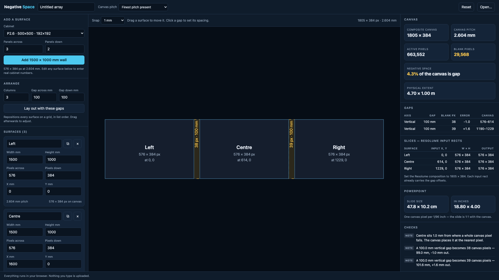

# Negative Space — user guide

## What it is for

Negative Space works out the canvas for an array of LED walls or projection surfaces with real
space between them, counting each gap as blank pixels, so content laid out across the whole array
behaves as though that space were part of the picture.

So a graphic sliding across the stage disappears behind each gap and comes out the far side at
the speed it was really travelling, instead of jumping.

*Three 1500 × 1000 mm P2.6 surfaces with 100 mm gaps: a 1805 × 384 composite canvas, 4.3 % of it gap, the blank pixels each gap costs and the rounding error it carries, plus the Resolume input rects and the PowerPoint slide size that fall out of it.*

To do that, the composition has to be bigger than the sum of the screens. It has to include
the gaps as blank pixels, and this works out how many.

## The quick version

1. **Add your surfaces.** Pick a cabinet from the presets and say how many panels across and
   down, or type the real numbers straight into any surface card.
2. **Set the spacing.** Either drag surfaces around the canvas, or click a shaded gap and
   type the exact distance in millimetres. Everything to the right of it slides along.
3. **Read the canvas size** in the top right. That's what you set your composition to.
4. **Export** whatever you need.

## Entering surfaces

Each surface needs four numbers: its **active image area** in millimetres, and its **native
resolution** in pixels. The pitch is one divided by the other, and the tool shows it back to
you, so check it against the cabinet's spec sheet. If it reads 2.604 mm for a product sold as
"P2.6", that's right: the pitch of a 500 mm cabinet with 192 pixels across really is
2.604166… mm, and the rounded figure is the marketing name, because 2.604166… doesn't fit on
the box.

Use the *active area*, not the cabinet's outside dimension. The frame around a panel is part
of the gap, not part of the picture.

Projection surfaces work the same way: the physical size of the projected image, and the
projector's raster.

## Mixed pitches

If your surfaces have different pitches, the canvas has to pick one. **Finest pitch present**
is the default and almost always right: it means no surface is ever asked to show fewer
canvas pixels than it physically has, so the fine walls stay sharp and the coarse ones are
downsampled into.

Choosing **Coarsest** does the reverse and upsamples into your finest wall. That's a real
decision with a real look, which is why it's offered rather than hidden. **Set manually** is
for matching a canvas that already exists.

Any surface whose pitch differs from the canvas pitch is listed under Checks, with the scale
factor, so you always know which surfaces are being resampled.

## Reading the gaps

Each gap is reported as:

- **Gap:** the physical distance you entered.
- **Blank px:** how many canvas pixels that is.
- **Error:** how far the whole number of pixels is from the real distance. A 100 mm gap at
  2.604 mm pitch is 38.4 px; rounded to 38 it's 1.04 mm short. That's normal and almost
  never matters, but it's shown rather than hidden.
- **Canvas:** the exact columns (or rows) of the canvas that are dead.

### Why two identical gaps can differ by one pixel

You'll sometimes see two gaps, both entered as 100 mm, come out as 38 px and 39 px. That's
correct.

Surfaces are positioned by rounding where they really are, not by stacking up rounded gaps.
A wall at 1600 mm is 614.4 canvas pixels along, so it's placed at 614; one at 3200 mm is
1228.8, so it's placed at 1229. The gutters either side of that fractional drift differ by
one pixel.

The alternative would be to repeat an identical rounded gap, which looks tidier and is
worse: the error builds up, and by the tenth wall in a row the canvas is millimetres out of
step with the floor. This way every surface stays within half a pixel of its true position,
however long the row.

## The exports

**PDF report:** a scale plan of the canvas with the gaps shaded and dimensioned, plus every
table. This is the one to print and take to site.

**Guide PNG / SVG:** a plate at the canvas resolution, *pixel for pixel*, with the gaps
hatched and each surface labelled. Put it on a PowerPoint slide background, in an After
Effects comp, or as a Photoshop layer at 100%, and design against it. If some text is going
to fall down a gap, you'll see it fall.

**PowerPoint:** a starter deck already at the right slide size, with the surfaces and gaps
drawn on the first slide. PowerPoint caps slides at 56 inches, so a large array is scaled to
fit; the aspect ratio and every proportional position are exact, which is what matters. The
panel also shows the slide size in cm and inches if you'd rather set up your own deck.

**Resolume preset / AdvancedOutput.xml:** the screen setup, with each slice's input
rectangle already offset by the gaps.

> **Back up your existing `AdvancedOutput.xml` before replacing it.** Arena reads it at
> launch and rewrites it on quit, so a bad swap loses the setup that was there. The preset
> form is safer: drop it in `Presets/Advanced Output/` and load it from inside Arena.

Each screen comes in as a **Virtual** output device, because a real display's identifiers
belong to the machine Arena is running on. Assign them to physical outputs once they're
loaded.

**CSV:** every surface and gap, for a spreadsheet next to the rigging plot.

**Save project:** a JSON file of your inputs. Reload it with **Open…**. Your work is also
kept in the browser automatically between visits.

## Checks

The panel lists anything worth knowing:

- **Errors:** overlapping surfaces, or a surface with a missing dimension.
- **Warnings:** non-square pixels (usually a typo in the physical size), or a gap too small
  to survive the canvas pitch at all.
- **Notes:** surfaces being resampled, and gaps whose rounding is more than a quarter of a
  pixel.

## Before you trust it on a show

The arithmetic is tested, and the PowerPoint file has been opened in real PowerPoint. **The
Resolume file has never been round-tripped through a running Arena.** Load it, put a test
pattern up, and check one slice against the wall before you rely on it.
